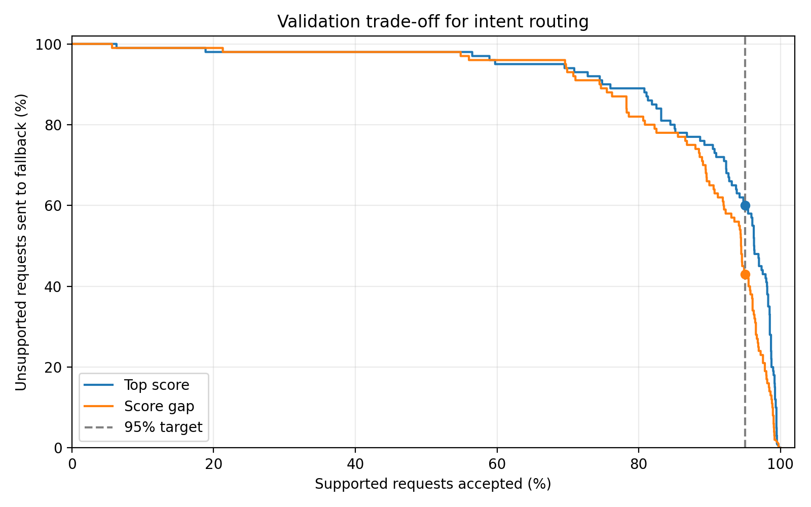

# Selective Intent Routing with Abstention

**Authors** T. Prem Sai, M. Suhaas Choudary, Santosh Bangaru, A. Yaswanth, P. Venkata Jagadeesh

## Reproduce the experiment

Install the Python dependencies from the repository root.

```sh
python -m pip install -r requirements.txt
```

Open [intent_routing.ipynb](intent_routing.ipynb) in Jupyter, VS Code, or Google Colab. Run the experiment cells in order. The notebook downloads the official CLINC150 data on the first run. The final ZIP download cell is optional and runs in Google Colab.

The notebook writes test metrics, per-request predictions, and the validation plot to the results directory. The [test metrics](results/test_metrics.csv) and the validation plot from the final evaluation are included here.

## Abstract

An intent router assigns a user message to one of the actions supported by a task-oriented agent. An always-route policy can send an unsupported request to an unrelated action. This project trains a TF-IDF and logistic regression classifier on CLINC150 and compares an always-route baseline with two fallback policies based on the classifier's scores. Each fallback threshold was selected to retain at least 95% of supported validation requests. On the held-out test set, the top-score policy sent 57.40% of unsupported requests to fallback while accepting 95.31% of supported requests. The score-gap policy rejected 43.60% of unsupported requests and accepted 95.69% of supported requests.

## 1. Problem statement and objective

- **Problem.** An always-route classifier assigns every request to one of its supported intents. A request for an unavailable action can therefore reach the wrong handler.
- **Research question.** At a validation target of 95% supported-request acceptance, how many unsupported requests can a score-based fallback catch?
- **Hypothesis.** Raising the threshold will catch more unsupported requests while also sending more supported requests to fallback.

## 2. Dataset

CLINC150 contains English queries covering 150 supported intents and a separate set of out-of-scope queries. The experiment uses the official splits from `data_full.json`.

| Stage | Supported requests | Unsupported requests used |
|---|---:|---:|
| Model training | 15,000 | — |
| Validation | 3,000 | 100 |
| Held-out evaluation | 4,500 | 1,000 |

## 3. Methodology

1. **Text representation.** The TF-IDF vectorizer was fit on the training split. It used word unigrams and bigrams, retaining terms that appeared in at least two training messages. The resulting vocabulary contained 11,860 features.
2. **Intent classifier.** Multiclass logistic regression learned which features were associated with each of the 150 supported intents. The experiment used scikit-learn 1.7.2 with `C=4.0`, the `lbfgs` solver, and a maximum of 500 iterations.
3. **Baseline.** Route every request to the intent with the highest predicted probability.
4. **Top-score fallback.** Route to the highest-scoring intent when its probability meets or exceeds the threshold. Otherwise, send the request to fallback.
5. **Score-gap fallback.** Apply a threshold to the difference between the two highest probabilities. A small gap indicates that two supported intents scored similarly.
6. **Threshold selection.** For each fallback policy, the highest cutoff that retained at least 95% of supported validation requests was selected and fixed before test evaluation.

**What fallback does in the notebook.** The classifier still predicts an intent and produces a score for every message. If the score used by the routing policy falls below its cutoff, the router marks the request as rejected and the simulated handoff ends there. The notebook saves the predicted intent, scores, and acceptance decision for evaluation, then continues evaluating the remaining messages.

## 4. Evaluation

| Metric | Calculation |
|---|---|
| Supported acceptance | Accepted supported requests ÷ all supported requests |
| Unsupported routing rate | Routed unsupported requests ÷ all unsupported requests |
| Unsupported rejection rate | Unsupported requests sent to fallback ÷ all unsupported requests |
| Accuracy among accepted supported requests | Correctly routed supported requests ÷ accepted supported requests |

The unsupported rejection rate is the complement of the unsupported routing rate. The latter is the main measure of how often unsupported messages slip through.

## 5. Results

| Policy | Threshold | Supported accepted | Unsupported routed | Unsupported rejected | Correct among accepted supported |
|---|---:|---:|---:|---:|---:|
| Always route | — | 4,500 / 4,500 (100.00%) | 1,000 / 1,000 (100.00%) | 0 / 1,000 (0.00%) | 4,077 / 4,500 (90.60%) |
| Top-score threshold | 0.112562 | 4,289 / 4,500 (95.31%) | 426 / 1,000 (42.60%) | 574 / 1,000 (57.40%) | 3,993 / 4,289 (93.10%) |
| Score-gap threshold | 0.027281 | 4,306 / 4,500 (95.69%) | 564 / 1,000 (56.40%) | 436 / 1,000 (43.60%) | 4,010 / 4,306 (93.13%) |



*Figure 1. Both cutoffs retained 95.00% of supported requests on validation. At those cutoffs, the top-score and score-gap policies sent 60.00% and 43.00% of unsupported validation requests to fallback, respectively. The table reports held-out test performance.*

Both fallback policies retained more than 95% of supported requests on test. At their selected cutoffs, the top-score policy caught 138 more unsupported requests than the score-gap policy and sent 17 more supported requests to fallback. Relative to always routing, the top-score policy sent 211 supported requests to fallback, or 4.69% of the supported test set.

Accuracy among accepted supported requests rose from 90.60% to about 93% under both fallback policies. This metric measures accuracy over the requests each policy accepted. Counting all 4,500 supported test requests, the number routed correctly was 4,077 for always route, 3,993 for top score, and 4,010 for score gap. The fallback policies reduced misroutes and also deferred some requests that the classifier would have routed correctly.

## 6. Error analysis

The examples below come from the held-out predictions of the top-score policy. The explanations are hypotheses based on the wording and scores.

| Failure type | Test message | True label | Predicted label and top score | Possible explanation |
|---|---|---|---|---|
| Unsupported request routed | “who invented the internet” | Out of scope | `who_made_you`, 0.3833 | The wording asks about a creator, which may resemble requests about who created the assistant. |
| Supported request rejected | “what's the spanish word for pasta” | `translate` | `translate`, 0.0955 | The best label was correct, but its score fell below the 0.112562 cutoff. |
| Supported request routed incorrectly | “dog in spanish” | `translate` | `change_language`, 0.3512 | The language name is relevant to both intents. The short phrasing leaves the requested action implicit. |

## 7. Limitations and conclusion

- **Limitations.** CLINC150 uses English, single-intent examples. The results describe a simulated routing decision on this benchmark. The experiment uses one classifier and one validation target, so performance may shift with a different intent inventory or mix of unsupported requests. Some unsupported requests received scores well above the cutoff.
- **Conclusion.** The top-score threshold rejected 57.40% of unsupported test requests while retaining 95.31% of supported requests. It caught more unsupported requests than the score-gap policy at the chosen operating points. The 426 unsupported requests that still passed show the limits of relying on the top intent score alone.

## References

- Larson, S., et al. (2019). *An Evaluation Dataset for Intent Classification and Out-of-Scope Prediction*. [EMNLP-IJCNLP](https://aclanthology.org/D19-1131/)
- [CLINC150 dataset repository](https://github.com/clinc/oos-eval)

